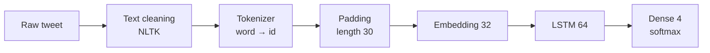

<div align="center">

# 🐦 Twitter Sentiment Analysis

**Classifying tweets into 4 sentiment classes with an LSTM neural network**

[](https://www.python.org/)
[](https://www.tensorflow.org/)
[](https://keras.io/)
[](https://www.nltk.org/)
[](https://colab.research.google.com/github/mahammadhajiiyev/twitter-sentiment-analysis-lstm/blob/main/Twitter_Sentiment_Analysis.ipynb)

</div>

---

## 📌 Overview

A Natural Language Processing (NLP) project that reads a tweet and predicts its sentiment toward a brand or entity:

| 😊 Positive | 😠 Negative | 😐 Neutral | 🤷 Irrelevant |
|:---:|:---:|:---:|:---:|

The model is a compact **Embedding → LSTM** network that reaches **96.6% validation accuracy**.

## 📊 Dataset

| | |
|---|---|
| **Source** | [Kaggle — Twitter Entity Sentiment Analysis](https://www.kaggle.com/datasets/jp797498e/twitter-entity-sentiment-analysis) |
| **Training tweets** | 69,769 (after cleaning) |
| **Validation tweets** | 999 |
| **Classes** | 4 — Positive, Negative, Neutral, Irrelevant |

## 🔧 Workflow



1. **Text cleaning** — lowercasing, removing URLs, mentions and punctuation, handling emojis, stopword removal with NLTK.
2. **Tokenization** — Keras `Tokenizer` builds a vocabulary of all unique words.
3. **Padding** — every tweet becomes a sequence of exactly **30 tokens**.
4. **Model**

   | Layer | Output | Purpose |
   |---|---|---|
   | `Embedding` | 32-dim vector per word | Learns word meanings |
   | `LSTM(64, dropout=0.1)` | 64 | Reads the tweet in order and captures context |
   | `Dense(4, softmax)` | 4 | Probability for each sentiment |

5. **Training** — 10 epochs.

## 🏆 Results

| Epoch | Train accuracy | Validation accuracy |
|:---:|:---:|:---:|
| 1 | 46.1% | 81.4% |
| 3 | 88.1% | 93.4% |
| 6 | 93.8% | 95.8% |
| **10** | **96.2%** | **96.6%** |

Train and validation accuracy stay close throughout training, so the model is **not overfitting**.

## 🚀 How to run

1. Click the **Open in Colab** badge above.
2. Upload your Kaggle API key (`kaggle.json`) when prompted — the dataset downloads automatically.
3. Run all cells.

To run locally:

```bash
pip install tensorflow pandas numpy matplotlib nltk emoji kaggle
jupyter notebook Twitter_Sentiment_Analysis.ipynb
```

## 📁 Project structure

```
twitter-sentiment-analysis-lstm/
├── Twitter_Sentiment_Analysis.ipynb   # cleaning, tokenization, LSTM model, training
└── README.md
```

## 🔮 Future improvements

- Bidirectional LSTM or GRU layers
- Pretrained word embeddings (GloVe, FastText)
- Fine-tune a transformer model (BERT / DistilBERT) and compare
- Evaluate on a larger held-out test set with a confusion matrix

## 👤 Author

**Mahammad Hajiyev** · [@mahammadhajiiyev](https://github.com/mahammadhajiiyev)
